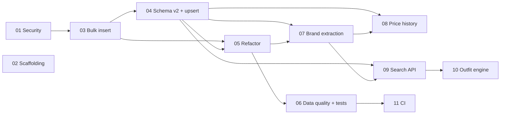

# Implementation Tasks

This directory contains self-contained implementation task specs for the **jubilant-enigma** fashion data pipeline. Each task is written so an AI agent (or engineer) can build it with no context beyond the repo and the task file itself.

## Project context (read first)

This repo ingests scraped Pakistani fashion e-commerce product data (CSV) into a MySQL `wardrobe_items` table:

- `ETL/pipeline.py` — Python ETL script (pandas + mysql-connector-python + python-dotenv). Extracts CSVs from `../data/raw/`, transforms them, saves processed copies to `../data/processed/`, and inserts rows into MySQL.
- `wardrobe-db/` — SQL schema (`sql/schema.sql`), migrations (`sql/migrations/`), seeds (`sql/seeds/`), and a bash migration runner (`scripts/run_migrations.sh`).

The long-term product direction is a fashion catalog + outfit recommendation platform for the Pakistani market (comparable to AuraFit and TrendCompare): multi-brand catalog, price comparison, occasion-based outfit matching (Eid, Mehndi, Wedding, Office, Casual), and eventually an AI stylist.

## Task list and ordering

| # | Task | Depends on | Scope |
|---|------|-----------|-------|
| 01 | [Security hardening](./task-01-security-hardening.md) | — | Remove committed credentials, add `.gitignore`, `.env.example` |
| 02 | [Project scaffolding](./task-02-project-scaffolding.md) | — | `requirements.txt`, `LICENSE`, README updates |
| 03 | [Bulk insert and batching](./task-03-bulk-insert.md) | 01 | Replace row-by-row inserts with batched `executemany` |
| 04 | [Schema v2: constraints, timestamps, upsert](./task-04-schema-v2-upsert.md) | 03 | Unique key on product URL, timestamps, idempotent loads |
| 05 | [Pipeline refactor](./task-05-pipeline-refactor.md) | 03, 04 | Shared column config, robust paths, exit codes, discount parsing |
| 06 | [Data quality and tests](./task-06-data-quality-and-tests.md) | 05 | Reject/quarantine bad rows, batch dedup, pytest suite |
| 07 | [Brand extraction](./task-07-brand-extraction.md) | 04, 05 | Derive `brand` from product URLs, normalize brand names |
| 08 | [Price history tracking](./task-08-price-history.md) | 04, 07 | `price_history` table, detect price changes across scrape runs |
| 09 | [Search and filter API](./task-09-search-api.md) | 04, 07 | FastAPI read-only API over the catalog |
| 10 | [Outfit matching engine](./task-10-outfit-engine.md) | 09 | Rule-based outfit bundles (clothing + shoes) by occasion/season/color |
| 11 | [CI pipeline](./task-11-ci.md) | 06 | GitHub Actions: lint + tests on push/PR |

Tasks 01 and 02 have no dependencies and can be built in parallel. Tasks 07/08 and 09 can proceed in parallel once 04 and 05 land.

## Conventions for implementing agents

- **Branching**: one branch and one PR per task. Reference the task file in the PR description.
- **Python**: Python 3.10+, follow existing code style in `ETL/pipeline.py` (logging via the `logging` module, docstrings on functions).
- **Migrations**: never edit an existing migration file; add a new numbered file under `wardrobe-db/sql/migrations/` and keep `wardrobe-db/sql/schema.sql` in sync as the canonical current schema.
- **Secrets**: never commit credentials. Read config from environment variables via `python-dotenv`.
- **Tests**: from task 06 onward, new behavior must ship with pytest coverage. Transform logic must be testable without a live database.
- **Acceptance criteria are the contract**: every checkbox in a task's Acceptance Criteria section must pass before the task is considered done.
